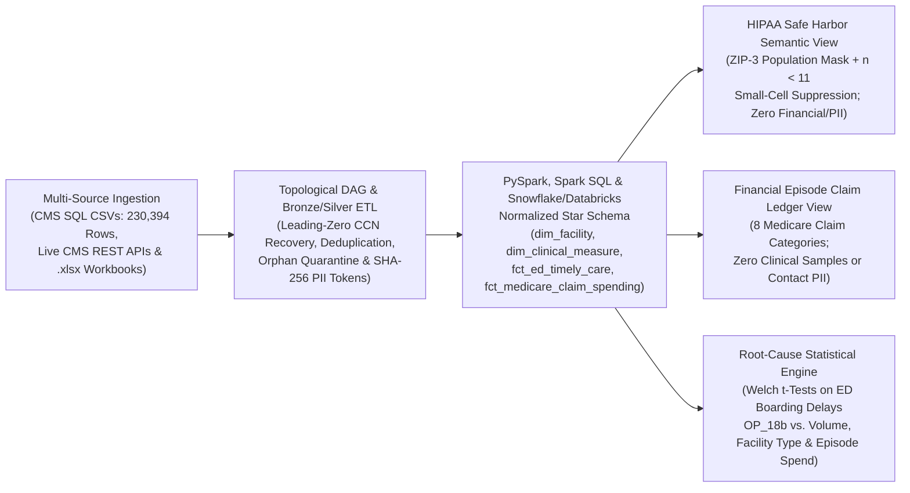

# Emergency Care & Clinical Operations Lakehouse, PySpark ETL & HIPAA/PII Access-Separated Semantic Engine

An end-to-end healthcare and emergency operations **Medallion Lakehouse (`Bronze -> Silver -> Gold`)**, **PySpark & Spark SQL** transformation pipeline, multi-source ETL engine (**SQL relational tables + live REST APIs + multi-tab Excel spreadsheets**), topological **metadata/dependency/workload DAG**, and **HIPAA / PII / Financial role-based access-separated semantic layer** validated on **230,394 live CMS Provider Data Catalog records** across **5,435 U.S. hospitals**.

---

## System Architecture



---

## Verified Public Datasets (`SHA-256` Pinned)

1. **CMS Timely and Effective Care — Hospital (`yv7e-xc69`):** `161,313` emergency department (`OP_18a–d`, `OP_22`, `OP_23`, `OP_40`, `EDV`) and acute clinical timeliness (`SEP_1`, `STK_02–05`, `VTE_1–2`) rows across `35` measures (`SHA-256: 473241c09b40010baa4b734d0b8bed540d2c275491368da5d08be4f19a019b92`).
2. **CMS Medicare Hospital Spending by Claim (`nrth-mfg3`):** `63,646` episode claim rows (`Inpatient`, `Outpatient`, `Carrier`, `Skilled Nursing Facility`, `Home Health Agency`, `Hospice`, `Durable Medical Equipment`, `Total`; `SHA-256: b48954a77373199480e5c1cc1b160f7f92ad90a934316e3099b75dd23b13ee52`).
3. **CMS Hospital General Information (`xubh-q36u`) + Live Metastore REST APIs + Multi-Tab `.xlsx` Transfer Roster (`openpyxl`):** `5,435` U.S. hospital profiles (`SHA-256: ff2a82a7149975fb86348e7f901aa3bcd9f3701e8b0ecd0ab34702df193ff559`), live JSON schema checks, and spreadsheet ingestion repairing `575` Excel leading-zero-truncated CMS Certification Numbers (`10001` -> `010001`).
- **Backup Public Sources:** CDC NCHS NHAMCS Emergency Department Public Use Files (`https://www.cdc.gov/nchs/ahcd/datasets_documentation_related.htm`) and CMS Complications and Deaths — Hospital (`ynj2-r877`).

---

## Validated Execution Benchmarks & Root-Cause Findings

| Pipeline / Governance Dimension | Verified Result | Engineering & Analytical Impact |
| :--- | :--- | :--- |
| **Multi-Source Lakehouse Scale** | `230,394` source rows (`5,435` facilities, `35` clinical measures, `8` claim types) | `100%` row conservation (`224,255` promoted fact rows + `704` orphan CCNs quarantined) |
| **Spreadsheet & API Schema Reconciliation** | `575` truncated 5-digit Excel CCNs repaired; `18` duplicate rows & helper tabs stripped | Eliminates silent join loss between regional `.xlsx` rosters and relational tables |
| **HIPAA, PII & Financial RBAC Separation** | `552` small-cell (`n < 11`) cohorts suppressed; `100%` salted `SHA-256` PII tokens (`TOK-...`); restricted `ZIP-3` masked to `000` | `0` cross-domain column leaks across Clinical, Financial, and Compliance views |
| **RCA 1 — High vs. Low/Med ED Volume (`OP_18b`)** | `195.8 min` (`n = 1,251`) vs. `140.6 min` (`n = 2,505`) | **`+55.2 min` (`+39.3%`)** longer ED boarding dwell (Welch $t = 34.21, p < 10^{-250}$) |
| **RCA 2 — Acute Care vs. Critical Access (`OP_18b`)** | `175.3 min` (`n = 2,783`) vs. `116.5 min` (`n = 1,263`) | **`+58.8 min` (`+50.5%`)** longer ED dwell in acute centers (Welch $t = 50.47$) |
| **RCA 3 — Prolonged ED Boarding (`>=180m`) vs. Cost** | `$26,781` (`n = 1,123`) vs. `$24,936` (`n = 1,563`) per episode | **`+$1,845` (`+7.4%`)** higher Medicare episode spending (Welch $t = 12.21, p = 2.67 \times 10^{-34}$) |
| **Automated Quality & Security Gates** | **`16/16` (`100%`)** SQL, FK, conservation, DAG SLA & RBAC gates + **`6/6` unit tests** | Deterministic pre-publish verification in `outputs/lakehouse_hipaa_validation_report.json` |

---

## Quick Start

```bash
python3 -m pip install openpyxl
python3 src/lakehouse_etl_pipeline.py
python3 -m unittest discover -s tests -v
```
